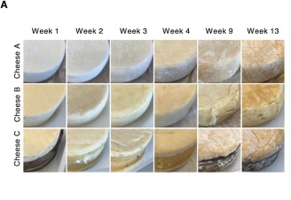
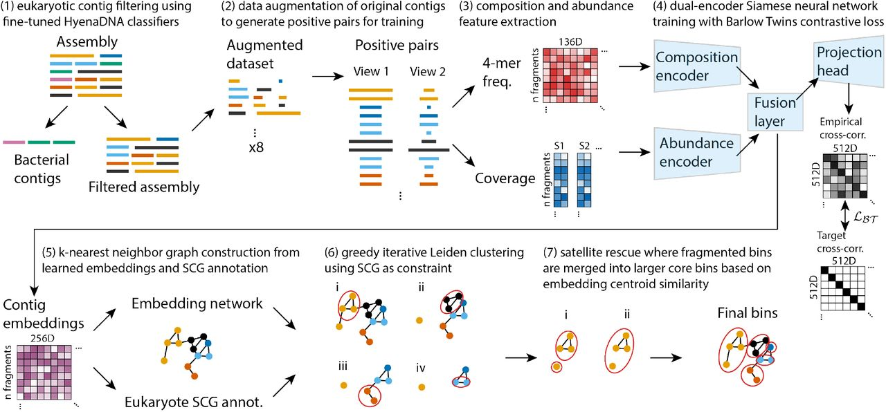
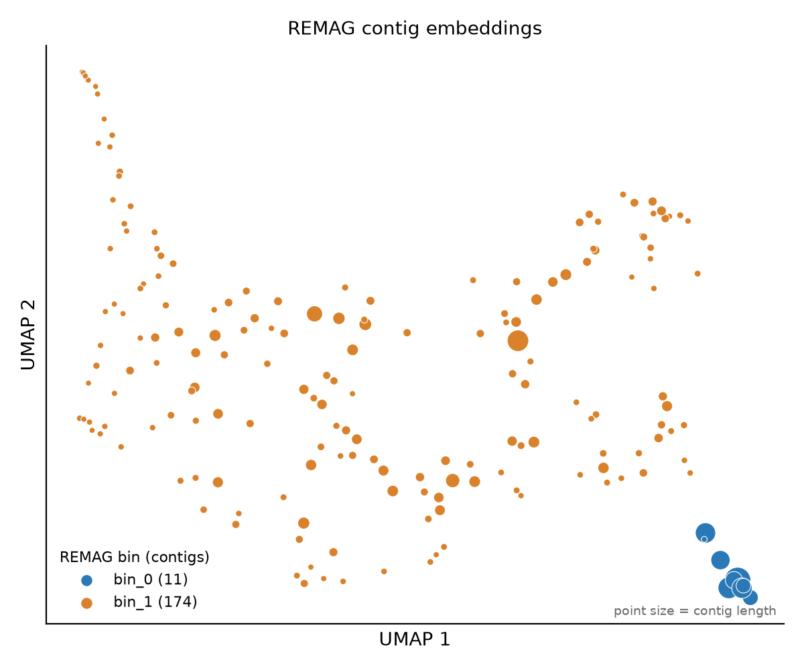
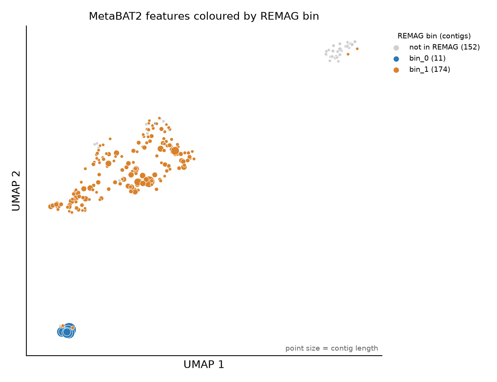

# Eukaryotic binning tutorial

## Background

Washed-rind cheeses (Beaufort, Morbier or Reblochon) are washed with brine during ripening. The salty, moist surface selects for a microbial community that forms the sticky, often orange rind, and is responsible for much of the strong aroma of these cheeses.

Early in this procesess, the curd surface is acidic and salty, and few bacteria can grow on it. Salt- and acid-tolerant yeasts colonise it first: they consume lactate and break down proteins, releasing ammonia, which raises the surface pH. This deacidification allows salt-tolerant bacteria to take over. Fungi also can influence which bacteria establish.

## Dataset

In this tutorial we will work with long-read metagenomic data from a washed-rind cheese, taken from [Saak et al. 2023, *mSystems*](https://doi.org/10.1128/msystems.00701-22) (run [SRR18495441](https://www.ncbi.nlm.nih.gov/sra/SRR18495441), BioProject [PRJNA778418](https://www.ncbi.nlm.nih.gov/bioproject/PRJNA778418)). The community was sequenced with PacBio HiFi. To keep run times short and to focus on eukaryotes, we built a smaller subset of the original run ([Zenodo](https://doi.org/10.5281/zenodo.23511123)). It contains 51,634 reads (~644 Mb). Reads from fungal species were sampled to give each species a similar depth (~16x). A random set of background reads was then added.



_Rinds of the three washed-rind cheeses during ripening. Our reads come from Cheese B at week 2. Figure 1A from [Saak et al. 2023](https://doi.org/10.1128/msystems.00701-22), [CC BY 4.0](https://creativecommons.org/licenses/by/4.0/)._

The goal of this tutorial is to demonstrate how to bin eukaryotic genomes from metagenomic data starting from the raw reads. We will use two different binning tools, MetaBAT2 and REMAG, and compare their results. We will also assess the quality of the bins with BUSCO and EukCC. Finally, we will compare the bins to a set of reference genomes to see how well they match.

Now for the next 15 minutes, please try to use what you learned in the previous sessions to 

1. Assembly with metamdbg (env Assembly)
2. mapping with minimap2 (env LongReads)
3. use samtools to get a bam file, sort it and index it (env LongReads)
4. run metabat2 (env LongReads)

<details><summary>Full solution is here, please try first</summary>
<p>


## Assembly

### Download the dataset

Let's create a data folder within binning and download the raw reads there. Note that as it is PacBio HiFi data, the reads are unpaired and stored in a single fastq.gz file.

```bash
mkdir -p Projects/Cheese_Tuto/data
cd Projects/Cheese_Tuto/data

wget -c https://zenodo.org/records/23511123/files/cheese_balanced_reads.fastq.gz

cd ..
```

### Activate the environment

Activate the environment which will be used for assembly. It contains metaMDBG and seqkit for quality control.

```bash
conda info --envs

conda activate Assembly
```

### Run metaMDBG

[metaMDBG](https://github.com/GaetanBenoitDev/metaMDBG) ([paper](https://www.nature.com/articles/s41587-023-01983-6))

```bash
cd ~/Projects/Cheese_Tuto
metaMDBG asm --in-hifi data/cheese_balanced_reads.fastq.gz --out-dir metamdbg --threads 16
```

### Assembly statistics

Let's inspect the assembly quality with seqkit ([GitHub](https://github.com/shenwei356/seqkit), [documentation](https://bioinf.shenwei.me/seqkit/usage/)). The result will be printed to the terminal.

```bash
cd ~/Projects/Cheese_Tuto
seqkit stats -a metamdbg/contigs.fasta.gz
```

> **Questions**
>
> - What does `-a` do?
> - What are the more informative columns?
> - How's the quality of the assembly looking?


## Mapping

Next, we need to determine the coverage of each contig by mapping the reads back to the assembly. This will be used for binning.

First, we activate the environment which contains minimap2 ([GitHub](https://github.com/lh3/minimap2), [manual](https://lh3.github.io/minimap2/minimap2.html)) and samtools ([GitHub](https://github.com/samtools/samtools), [documentation](https://www.htslib.org/doc/samtools.html)).

```bash
cd ~/Projects/Cheese_Tuto
conda activate LongReads

mkdir mapping
```

### Map reads to contigs

While for short reads bwa-mem is often used, for long reads minimap2 is the preferred mapper. We will use the `map-hifi` preset, which is optimized for PacBio HiFi reads.

```bash
cd ~/Projects/Cheese_Tuto
minimap2 -t 16 -ax map-hifi metamdbg/contigs.fasta.gz data/cheese_balanced_reads.fastq.gz > mapping/reads.sam
```

### Convert, sort and index

```bash
cd ~/Projects/Cheese_Tuto
samtools view -@ 16 -b -o mapping/reads.unsorted.bam mapping/reads.sam

samtools sort -@ 16 -o mapping/reads.bam mapping/reads.unsorted.bam

samtools index mapping/reads.bam
```

## Binning

```bash
conda activate binning
mamba install bioconda::seqkit
```

### MetaBAT2

[MetaBAT2](https://bitbucket.org/berkeleylab/metabat) is a widely used binning tool. It uses the coverage of contigs across samples and the tetranucleotide frequencies of contigs to cluster them into bins. We need to calculate the coverage of each contig first, which is done with the `jgi_summarize_bam_contig_depths` script from MetaBAT2.

```bash
cd ~/Projects/Cheese_Tuto
jgi_summarize_bam_contig_depths --outputDepth mapping/depth.tsv mapping/reads.bam

metabat2 -i metamdbg/contigs.fasta.gz -a mapping/depth.tsv -o metabat2/bin -t 16 --seed 42

seqkit stats -a metabat2/*.fa
```


</p>
</details>


### REMAG

[REMAG](https://github.com/danielzmbp/remag) is a tool we've developed for automated binning of eukaryotic MAGs. 

```bash
cd ~/Projects/Cheese_Tuto
remag metamdbg/contigs.fasta.gz -c mapping/reads.bam -o remag --min-contig-length 10000 --random-seed 42 --threads 16 -k

seqkit stats -a remag/bins/*
```



_REMAG workflow. Figure 1 from the [REMAG preprint](https://doi.org/10.64898/2026.03.05.709928)._

#### Inspecting REMAG output
From the extended output of REMAG (flag `-k`) we can see several things. The filtered eukaryotic sequences are stored in `remag/contigs.fasta_eukaryotic_filtered.fasta`.

```bash
cd ~/Projects/Cheese_Tuto
seqkit stats -a remag/contigs.fasta_eukaryotic_filtered.fasta
```

We can also see a summary of the eukaryotic single-copy core genes (markers) found in each bin. REMAG maps these markers to the contigs with miniprot and uses them to guide the clustering (steps 5 and 6 in the figure above). The marker statistics for the final bins are stored in `remag/core_gene_duplication_results.json`.

```bash
cd ~/Projects/Cheese_Tuto
python -m json.tool remag/core_gene_duplication_results.json
```

> **Questions**
>
> - How many markers were found in each bin (`total_genes_found`), and how many of them are single-copy?
> - Are any markers duplicated? What could a duplicated marker indicate?
> - Some duplications are found within a single contig (`within_contig_duplications`). Can these be explained by contamination?

Finally, REMAG stores the learned embedding of each contig in `remag/embeddings.csv`. Contigs from the same genome should be close to each other in this embedding space. Below, the embeddings were projected to two dimensions with UMAP and coloured by the bin REMAG assigned them to.



_UMAP of the REMAG contig embeddings from an example run, coloured by bin. Point size is proportional to contig length. Your bins may differ slightly._

> **Questions**
>
> - How well separated are the bins?
> - One bin is much more spread out than the other. What could explain that?

For comparison, here are the same contigs in the feature space MetaBAT2 uses (tetranucleotide frequencies and coverage), projected with UMAP and coloured by their REMAG bin.



_UMAP of tetranucleotide frequencies and coverage for all contigs ≥2.5 kb from the same example run, zoomed in on the contigs binned by REMAG. Grey contigs were removed by REMAG's eukaryotic filter. Point size is proportional to contig length._

> **Questions**
>
> - Are the two REMAG bins also separated in the MetaBAT2 feature space?
> - Compare this plot with the REMAG embeddings above. Which one separates the genomes more clearly?
> - Compare it with your MetaBAT2 bins. Which REMAG bin did MetaBAT2 split into several bins?

## Bin quality

To measure the quality of the bins, we will use two tools: BUSCO and EukCC. Both tools assess the completeness and contamination of the bins based on the presence of single-copy orthologs.

### BUSCO

Let's run BUSCO ([GitLab](https://gitlab.com/ezlab/busco), [user guide](https://busco.ezlab.org/busco_userguide.html)) with the standard eukaryota database on the 2 largest MetaBAT2 and the REMAG bins.

```bash
cd ~/Projects/Cheese_Tuto
busco -i remag/bins -m genome -l eukaryota -c 16
busco -i metabat2/bin.4.fa -m genome -l eukaryota -c 16
```

### EukCC

Let's also run EukCC ([GitHub](https://github.com/EBI-Metagenomics/EukCC), [documentation](https://eukcc.readthedocs.io/))

#### Download the database

```bash
cd ~/Projects/Cheese_Tuto
mkdir -p databases/eukccdb
cd databases/eukccdb
wget http://ftp.ebi.ac.uk/pub/databases/metagenomics/eukcc/eukcc2_db_ver_1.2.tar.gz
tar -xzvf eukcc2_db_ver_1.2.tar.gz
export EUKCC2_DB=$(realpath eukcc2_db_ver_1.2)
cd ../..
```

#### Run EukCC

```bash
cd ~/Projects/Cheese_Tuto
conda activate eukcc
eukcc folder --threads 16 --n_combine 0 -o eukcc_metabat2 metabat2
eukcc folder --threads 16 --n_combine 0 -o eukcc_remag remag/bins
```

> **Questions**
>
> - What does `--n_combine 0` do?

#### Results
Inspect the EukCC results. The output is a CSV file with the completeness and contamination estimates for each bin, including the taxonomy ID's of the reference markers used for the assessment.
```bash
cd ~/Projects/Cheese_Tuto
cat eukcc_remag/eukcc.csv
cat eukcc_metabat2/eukcc.csv
```

> **Questions**
>
> - Which binner looks better?
> - What happened in the other one?
> - What taxonomy did EukCC assign to the bins? 

## Comparison to references

Finally, let's identify the bins by comparing them to the reference genomes with skani ([GitHub](https://github.com/bluenote-1577/skani)). Average Nucleotide Identity (ANI) tells us which species a bin belongs to (≥95% is generally considered same species), and the aligned fractions give a reference-based estimate of completeness (`Align_fraction_ref`) and contamination (1 - `Align_fraction_query`).


### Download the references

```bash
cd ~/Projects/Cheese_Tuto
mkdir ref
cd ref

wget -c https://zenodo.org/records/23511123/files/cheese_fungal_references.fna.gz

wget -c https://zenodo.org/records/23511123/files/reference_taxonomy.tsv

cd ..
```

### Split the references into one file per genome
We need to split the reference fasta file into one file per genome, as skani requires a single genome per file. We will use seqkit for this.

```bash
cd ~/Projects/Cheese_Tuto
conda activate Assembly

gunzip ref/cheese_fungal_references.fna.gz

seqkit split -i --id-regexp '^([^|]+)\|' -O ref/genomes ref/cheese_fungal_references.fna

ls ref/genomes
```

### Run skani

```bash
cd ~/Projects/Cheese_Tuto
skani dist -t 16 -q metabat2/bin.*.fa remag/bins/* -r ref/genomes/*.fna -o skani_bins.tsv
```

### Add the taxonomy
Inspect the skani output and add the taxonomy from the reference_taxonomy.tsv file.

```bash
cd ~/Projects/Cheese_Tuto
cut -f2-6 skani_bins.tsv | column -t -s $'\t'

column -t -s $'\t' ref/reference_taxonomy.tsv
```

> **Questions**
>
> - Which species did you recover? Do MetaBAT2 and REMAG agree?
> - Does any bin match more than one reference above 95% ANI? What does that tell you about these species?
> - How do the reference-based completeness and contamination compare to the EukCC and BUSCO estimates?
> - Why might a bin have a low aligned fraction even if it is not contaminated?
